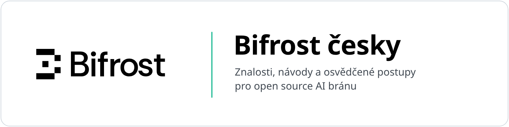

<picture>
  <source media="(prefers-color-scheme: dark)" srcset="assets/banner-dark.png">
  
</picture>

  
  
  
  

**Bifrost česky** je komunitní místo pro sdílení znalostí, návodů a osvědčených postupů k [Bifrostu](https://github.com/maximhq/bifrost), open source AI bráně od Maxim AI. Bifrost funguje jako LLM, MCP i agent gateway: jedno OpenAI-kompatibilní API pro lokální i cloudové modely s failoverem, vyvažováním zátěže, sémantickou cache, virtuálními klíči a rozpočty.

Najdete tu dvě věci:

- **Překlad dokumentace:** věrný český překlad úvodu a rychlého startu oficiální dokumentace.
- **Rychlé návody:** hlavní funkce v kostce. Vybírají to podstatné pro rozjezd a pro podrobnosti odkazují na dokumentaci výrobce.

Obojí průběžně aktualizujeme podle nových vydání. U každé stránky je uvedená verze dokumentace výrobce, ze které vychází.

📊 **[Bifrost OSS a Enterprise: co je v které edici](oss-a-enterprise.md)**

## Obsah

### Překlad dokumentace

| Oblast | Stránka | Stav |
|---|---|---|
| Úvod | [Bifrost AI Gateway](docs/overview.md) | ✅ |
| Rychlý start | [Nastavení brány](docs/quickstart/gateway/setting-up.md) | ✅ |
| Rychlý start | [Konfigurace poskytovatelů](docs/quickstart/gateway/provider-configuration.md) | ✅ |
| Rychlý start | [Nastavení ověřování](docs/quickstart/gateway/setting-up-auth.md) | ✅ |
| Rychlý start | [Integrace](docs/quickstart/gateway/integrations.md) | ✅ |
| Rychlý start | [Streamování odpovědí](docs/quickstart/gateway/streaming.md) | ✅ |
| Rychlý start | [Volání nástrojů](docs/quickstart/gateway/tool-calling.md) | ✅ |
| Rychlý start | [Multimodální AI](docs/quickstart/gateway/multimodal.md) | ✅ |
| Rychlý start | [Reranking](docs/quickstart/gateway/reranking.md) | ✅ |
| Rychlý start | [Decisions](docs/quickstart/gateway/decisions.md) | ✅ |

### Rychlé návody

| Oblast | Návod | Stav |
|---|---|---|
| Governance | [Virtuální klíče](navody/virtualni-klice.md) | ✅ |
| Governance | [Rozpočty a limity](navody/rozpocty-a-limity.md) | ✅ |
| Spolehlivost | [Fallbacky a vyvažování zátěže](navody/fallbacky-a-vyvazovani.md) | ✅ |
| Výkon a náklady | [Sémantická cache](navody/semanticka-cache.md) | ✅ |
| Provoz | [Observabilita: logy, metriky, OpenTelemetry](navody/observabilita.md) | ✅ |
| MCP | [MCP gateway](navody/mcp-gateway.md) | ✅ |
| Nasazení | [Docker a Helm](navody/nasazeni-docker-a-helm.md) | ✅ |
| Vývojáři | [CLI agenti: Claude Code a Codex CLI](navody/cli-agenti.md) | ✅ |
| Rozšíření | [Pluginy v kostce](navody/pluginy.md) | ✅ |
| Rozšíření | [Vlastní plugin v Go](navody/vlastni-plugin-go.md) | ✅ |
| Rozšíření | [Dynamická image pro vlastní pluginy](navody/dynamicka-image.md) | ✅ |

Chybí vám téma? Napište nám do [Diskuzí](https://github.com/bifrost-cz/bifrost-oss/discussions).

## Komunita a pomoc

- 💬 **[Diskuze](https://github.com/bifrost-cz/bifrost-oss/discussions):** dotazy, zkušenosti a ukázky nasazení, česky i slovensky.
- 🐞 **Chyby v Bifrostu** hlaste v oficiálním repozitáři [maximhq/bifrost](https://github.com/maximhq/bifrost/issues).
- 📚 **Oficiální dokumentace:** [docs.getbifrost.ai](https://docs.getbifrost.ai)
- 🗨️ **Discord Bifrostu:** [discord.gg/exN5KAydbU](https://discord.gg/exN5KAydbU)

## Enterprise a podpora v ČR a SK

Bifrost Enterprise přidává jednotné přihlášení (SSO) a role, audit, guardrails, provoz v clusteru, napojení na trezory tajemství a Bifrost Edge pro koncová zařízení (v programu včasného přístupu). Nasadíte ho u sebe, ve VPC i bez připojení k internetu.

[think private](https://thinkprivate.ai/bifrost) je partnerem pro Bifrost v Česku a na Slovensku. Pomůžeme s architekturou, nasazením a provozem. Přehled rozdílů mezi edicemi: [OSS a Enterprise](oss-a-enterprise.md).

👉 **[Nezávazná konzultace](https://thinkprivate.ai/bifrost)** · info@thinkprivate.ai

## Jak přispět

- Opravu překladu pošlete jako pull request, nápady a dotazy pište do [Diskuzí](https://github.com/bifrost-cz/bifrost-oss/discussions).
- Nikdy nevkládejte API klíče, hesla ani jiné citlivé údaje. V ukázkách používejte zástupné hodnoty.

## Licence

Překlady oficiální dokumentace i rychlé návody z ní odvozené jsou stejně jako originál pod licencí [Apache 2.0](LICENSE). Podrobnosti v [LICENSE-docs.md](LICENSE-docs.md).

---

Neoficiální komunitní projekt, který spravuje think private, partner pro Bifrost v ČR a SK. Nejde o oficiální produkt ani dokumentaci Maxim AI. Bifrost je ochranná známka H3 Labs, Inc. (Maxim AI).
